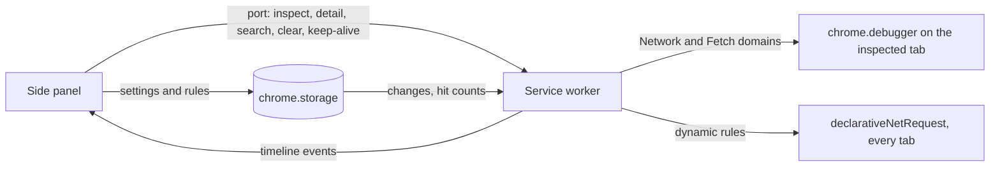

# Overview

A Manifest V3 extension for Chromium browsers 120+.  
The side panel shows and edits; the service worker captures traffic and runs the rules.

- **Runtime:** Chromium 120+, Manifest V3
- **Source:** TypeScript, no UI framework, bundled by esbuild
- **Tests:** Vitest

## How it works



| Feature                      | Engine                                | Scope                        |
| ---------------------------- | ------------------------------------- | ---------------------------- |
| Timeline, bodies, search     | `chrome.debugger`, Network domain     | the tab the panel inspects   |
| Rules marked `Inspected tab` | `chrome.debugger`, Fetch domain       | the tab the panel inspects   |
| Rules marked `All tabs`      | `declarativeNetRequest` dynamic rules | every tab, panel open or not |
| Cookie Jar                   | `chrome.cookies`                      | the inspected page's URL     |

One rule engine in `src/Common/Rules` serves the worker, the panel's testers and the timeline:

- The planner picks where each rule works and compiles `declarativeNetRequest` rules.
- The pipeline runs rules in order over a request and a response draft.
  The debugger runs it for real; the testers and the timeline run it as a simulation.

Settings live in `chrome.storage.local`.  
The worker watches them and resyncs the rules, so the panel only writes settings.  
Hit counts and variables live in `chrome.storage.session`.  
The kill switch removes every dynamic rule and turns Fetch interception off; capture keeps running.

While the debugger is attached, Chrome shows a "started debugging this browser" bar.  
Cancelling it detaches; the header offers Reattach.

## Repository layout

```
Rewire/
├─ src/
│  ├─ Contracts/          # types shared by worker, panel and storage
│  ├─ Common/             # pure logic: rules engine, code generation, search, diff, URLs, storage clients
│  ├─ Background/         # service worker
│  │  ├─ main.ts          # composition root
│  │  ├─ Endpoints/       # one folder per panel command
│  │  └─ Features/        # Capture, Interception, NetworkRules, Rules, Inspection, ...
│  └─ SidePanel/          # side panel
│     ├─ main.ts          # composition root
│     ├─ Core/            # store, worker connection, DOM helpers
│     └─ Features/        # Shell, Traffic, Inspector, Rules, Cookies, Client
├─ tests/                 # mirrors src, one *Tests.ts per type
├─ public/                # manifest.json and icons
├─ scripts/build.mjs      # esbuild bundle to dist/
├─ docs/
├─ Invoke-Test.ps1        # type check and tests
├─ Start-Debug.ps1        # watch build and a browser profile that loads it
├─ Publish-Extension.ps1  # test, bump the version, build, zip for manual upload
└─ Compress-Source.ps1    # zip the source, leaving out what git ignores
```

## Conventions

- One class per file, the file named after it, in a folder per feature; its interface and small argument types may sit beside it.
- Browser API clients and the strategies picked from registries come as an interface and a class.
- Interfaces that classes implement take an `I` prefix; data shapes don't.
- Expected failures return `Result<T>`; `try`/`catch` wraps browser APIs, network calls and parsing only.
- Rule lists and registries over `if` chains, named constants over magic numbers.
- Enums start at `1`.
- Tests are named `method_WhenCondition_ShouldOutcome`, with parameters in brackets after the condition, and keep `// Arrange`, `// Act`, `// Assert`.

## Theme and width

The panel follows the system theme each time it opens.  
The header's sun or moon button switches to the other theme until the panel closes.  
Below 420 px the header, rows and tables reflow to one column.

## Permissions

| Permission                      | Why                                                            |
| ------------------------------- | -------------------------------------------------------------- |
| `debugger`                      | Read request and response bodies, and run inspected-tab rules. |
| `declarativeNetRequest`         | Run all-tabs rules.                                            |
| `declarativeNetRequestFeedback` | Count hits of all-tabs rules and name them in the timeline.    |
| `alarms`                        | Resync rules with a time window every minute.                  |
| `cookies`                       | Read and edit HttpOnly and Secure cookies.                     |
| `storage`                       | Keep settings, rules, hit counts and variables.                |
| `sidePanel`                     | Open the panel from the toolbar button.                        |
| `<all_urls>`                    | Rules and cookies work on whatever site the developer targets. |
