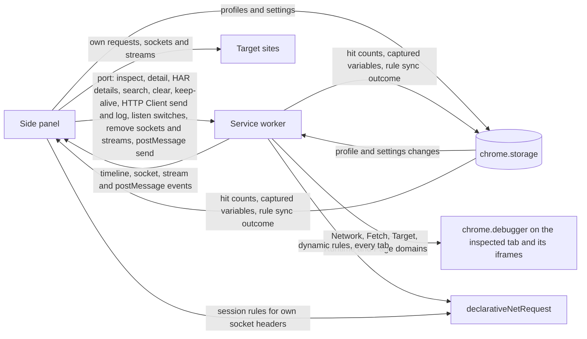

# Overview

A Manifest V3 extension for Chromium browsers 126+.  
The side panel shows and edits; the service worker captures traffic and runs the rules.

- **Runtime:** Chromium 126+, Manifest V3, for iframe debugger sessions and streamed event-stream bodies
- **Source:** TypeScript, no UI framework, bundled by esbuild; panel styles in SCSS, compiled by sass
- **Tests:** Vitest, beside their source as `src/**/<Name>.test.ts`

## How it works



| Feature                      | Engine                                | Scope                        |
| ---------------------------- | ------------------------------------- | ---------------------------- |
| Timeline, bodies, search     | `chrome.debugger`, Network domain     | the tab the panel inspects; up to 5 tabs it left keep their timeline |
| Cross-origin iframes         | `chrome.debugger`, Target domain, one flat session per iframe | the iframes of the inspected tab |
| Page sockets and streams     | `chrome.debugger`, Network domain     | the tab the panel inspects and its iframes, while their listen switch is on |
| postMessage capture          | `chrome.debugger`, Runtime binding and Page script | the tab the panel inspects and its iframes, while its listen switch is on |
| postMessage send             | `chrome.debugger`, Runtime domain     | the page or iframe you pick  |
| Own sockets and streams      | `WebSocket` and streaming `fetch` in the panel | the URL you type     |
| Own socket handshake headers | `declarativeNetRequest` session rules | that socket URL, until the socket closes |
| HAR Inspector                | the panel alone                       | the opened file              |
| Rules marked `Inspected tab` | `chrome.debugger`, Fetch domain       | the tab the panel inspects   |
| HTTP Client requests `fetch` can't send | `chrome.debugger`, Fetch domain | the side panel itself, while it sends |
| Rules marked `All tabs`      | `declarativeNetRequest` dynamic rules | every tab, panel open or not |
| Cookie Jar                   | `chrome.cookies`                      | the inspected page's URL     |

The timeline takes every Fetch, XHR, Ping (`navigator.sendBeacon`) and Document request, so analytics beacons, page navigations, form posts and iframe documents too.  
`Network.requestWillBeSent` adds the row as the request goes out; the response, its extra info, `loadingFinished` with the body, and `loadingFailed` fill it in, and each redirect hop is split off into a row of its own.

One rule engine in `src/Common/Rules` serves the worker, the panel's testers and the timeline:

- The planner picks where each rule works and compiles `declarativeNetRequest` rules.
- The pipeline runs rules in order over a request and a response draft.
  The debugger runs it for real; the testers and the timeline run it as a simulation.

Settings live in `chrome.storage.local`: the profiles, each with its rules and typed variables, which one is active, the **Interception** switch, the pinned endpoints and the testers' sample URLs.  
The worker watches them and resyncs the active profile's rules, so the panel only writes settings.  
Hit counts, captured variables and the outcome of the last rule sync live in `chrome.storage.session`; the worker writes them and the panel reads them.  
The panel keeps its own view preferences, the theme and the Traffic split, in its `localStorage`; see [Privacy](Privacy.md).  
Turning the header's **Interception** switch off removes every dynamic rule and turns Fetch interception off; capture keeps running.

While the debugger is attached, Chrome shows a "started debugging this browser" bar.  
Cancelling it detaches; the header offers Reattach.  
A panel that fails to start shows only `Rewire couldn't start:` and the reason.

## Repository layout

```
Rewire/
├─ src/                   # tests sit beside their source as <Name>.test.ts
│  ├─ Contracts/          # types shared by worker, panel and storage
│  ├─ Common/             # shared by worker and panel: rules engine, profiles, request snippets, HAR, search, JWT, URLs, storage clients, Result, RegexCache, object helpers
│  ├─ Background/         # service worker
│  │  ├─ main.ts          # composition root
│  │  ├─ Core/            # worker helpers: BoundedMap, TabScopedKey
│  │  ├─ Endpoints/       # one folder per panel command, routed by PanelEndpointRouter
│  │  └─ Features/        # Capture, Debugging, Interception, NetworkRules, Rules, Inspection, Sessions, Frames, Live, PostMessages, ...
│  └─ SidePanel/          # side panel
│     ├─ main.ts          # composition root
│     ├─ index.html       # panel page
│     ├─ app.scss         # panel styles
│     ├─ theme/           # shared light and dark palette, a copy of C:\Repos\DevToolbox\Css\Theme\
│     ├─ Core/            # store, worker connection, theme, DOM helpers
│     └─ Features/        # Shell, Traffic, Inspector, Rules, Profiles, Cookies, Client, WsClient, SseClient, PostMessages, HarInspector, Live, Frames, Jwt
├─ public/                # manifest.json and icons
├─ scripts/build.mjs      # esbuild bundle and sass compile to dist/
├─ docs/                  # RuleJson.md also ships in the panel as the rule format; a test checks it against the code
├─ vitest.config.ts       # test projects: logic and panel
├─ Invoke-Test.ps1        # type check and tests
├─ Start-Debug.ps1        # watch build and a browser profile that loads it
├─ Publish-Extension.ps1  # stamp the version, test, build, zip for manual upload
└─ Compress-Source.ps1    # zip the source, leaving out what git ignores
```

## Build output

`scripts/build.mjs` clears `dist/` and writes:

- `manifest.json` and `icons/`, copied from `public/`
- `background.js`, the service worker bundle from `src/Background/main.ts`
- `sidepanel/index.html`, `sidepanel/main.js` from `src/SidePanel/main.ts`, and `sidepanel/app.css` from `src/SidePanel/app.scss`
- source maps next to each bundle and the stylesheet

With `--watch`, esbuild rebuilds the bundles, and `public/`, `index.html` and the SCSS files are copied or recompiled on save.  
`Publish-Extension.ps1` packages `dist/` without the source maps.

## Tests

Vitest runs two projects from `vitest.config.ts`, so every test file lands in one of them:

- `panel`: `src/SidePanel/**/*.test.ts`, in happy-dom, with `.md` files imported as text
- `logic`: every other `src/**/*.test.ts`, in Node

`tsc --noEmit` type-checks all of `src`, tests included.  
`Invoke-Test.ps1` runs both; see the [README](../README.md#test).

## Conventions

The code follows the DevToolbox style guides in `C:\Repos\DevToolbox\.claude\docs\`: `javascript.md`, `css.md` and `html.md`.  
`src/SidePanel/theme/` is a byte copy of `C:\Repos\DevToolbox\Css\Theme\`; change the palette there and copy it over.

- One export per file, and the file name is the export's name: `TimelineStore.ts`, `delayAsync.ts`.
  A type that only describes its value stays with it, as `type RuleTypeId` beside `RULE_TYPE_IDS` in `RuleTypeId.ts`.
  Peer exports with no main one become a folder named after the group, one file each, as `Debugging/CdpTypes/`.
- Interfaces carry no `I` prefix; the interface keeps the bare name and its implementation takes a prefix.
  `Chrome<Name>` is a thin adapter over a browser API, `chrome.*` or another, such as `ChromeClipboardClient` over `navigator.clipboard`; `Default<Name>` is any other implementation.
- Constants are `UPPER_SNAKE_CASE`, and frozen objects (`Object.freeze({ ... } as const)`) stand in for enums.
  Objects of functions, such as `SearchPattern`, stay PascalCase.
- Functions that return a promise end in `Async`, Rewire's own interface methods included, such as `handleAsync`; only names fixed by an outside API are exempt.
- Functions with three or more parameters take one options object.
- Expected failures return `Result<T>`; `try`/`catch` wraps browser APIs, network calls and parsing only, often through `Result.attempt` or `Result.attemptAsync`, which turn a throw into a failure.
- Rule lists and registries over `if` chains, named constants over magic numbers.
- Tests sit beside their source as `<Name>.test.ts`, are named `method_WhenCondition_ShouldOutcome`, and keep `// Arrange`, `// Act`, `// Assert`.

## Theme and width

The theme is System, Light or Dark.  
The panel starts on System, which follows the OS setting live.  
The header's moon or sun button switches to Dark or Light; System holds only until the button is first pressed.  
The choice is kept in the panel's `localStorage` as `rewire.theme` and restored on open.  
The resolved theme, `light` or `dark`, is always written to `<html data-theme>`.

- The view tabs mark the active one with a line along its top.
  When they don't fit, the tab bar scrolls sideways, with the mouse wheel too, under a thin scrollbar.
- Up to 560 px wide, the header wraps and hides the brand, rule rows wrap, name and value lists such as headers and JWT claims put each value under its name, the rule catalog takes one column, the HTTP Client's method and URL take a line each, cookies show one field per line, and the postMessage send bar takes two lines.
- From 720 px wide, Traffic puts the timeline and the inspector side by side instead of one above the other.
  The split between them, and whether the inspector is folded away, are kept in `localStorage` as `rewire.splitRatio` and `rewire.inspectorCollapsed`.
- A **Skip to main content** link, shown on keyboard focus, jumps past the header and the tabs, and buttons that show only an icon carry an `aria-label`.

## Permissions

| Permission                      | Why                                                            |
| ------------------------------- | -------------------------------------------------------------- |
| `debugger`                      | Read request and response bodies, follow the page's iframes, sockets, event streams and postMessage messages, run inspected-tab rules, and send HTTP Client requests that `fetch` refuses, such as `GET` with a body. |
| `declarativeNetRequest`         | Run all-tabs rules, and set the handshake headers of your own sockets. |
| `declarativeNetRequestFeedback` | Count hits of all-tabs rules.                                  |
| `alarms`                        | Resync rules with a time window every minute.                  |
| `cookies`                       | Read and edit HttpOnly and Secure cookies.                     |
| `storage`                       | Keep settings, profiles, hit counts and variables.             |
| `sidePanel`                     | Open the panel from the toolbar button.                        |
| `<all_urls>`                    | Rules and cookies work on whatever site the developer targets. |
